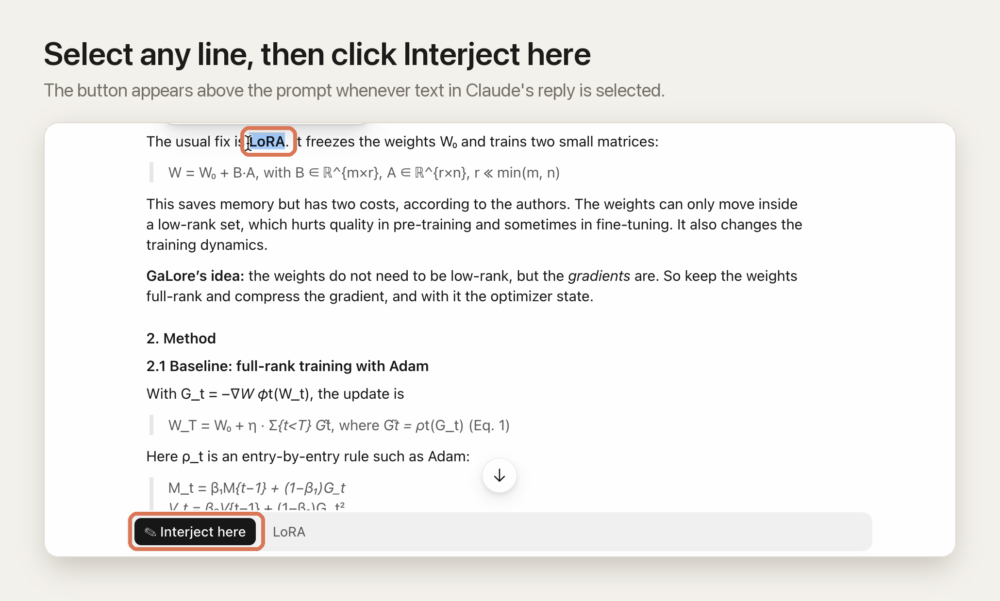
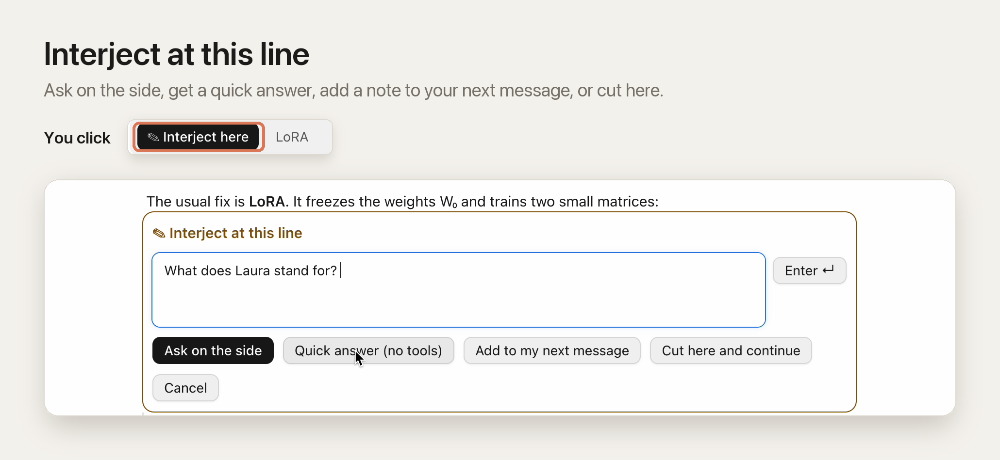
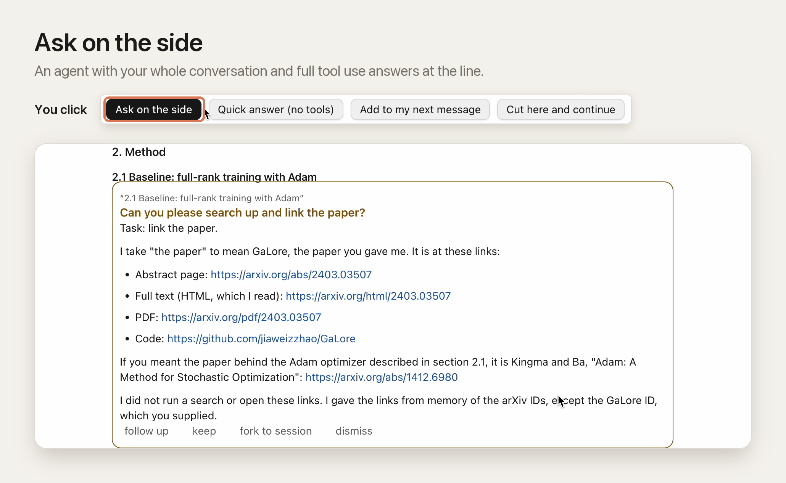
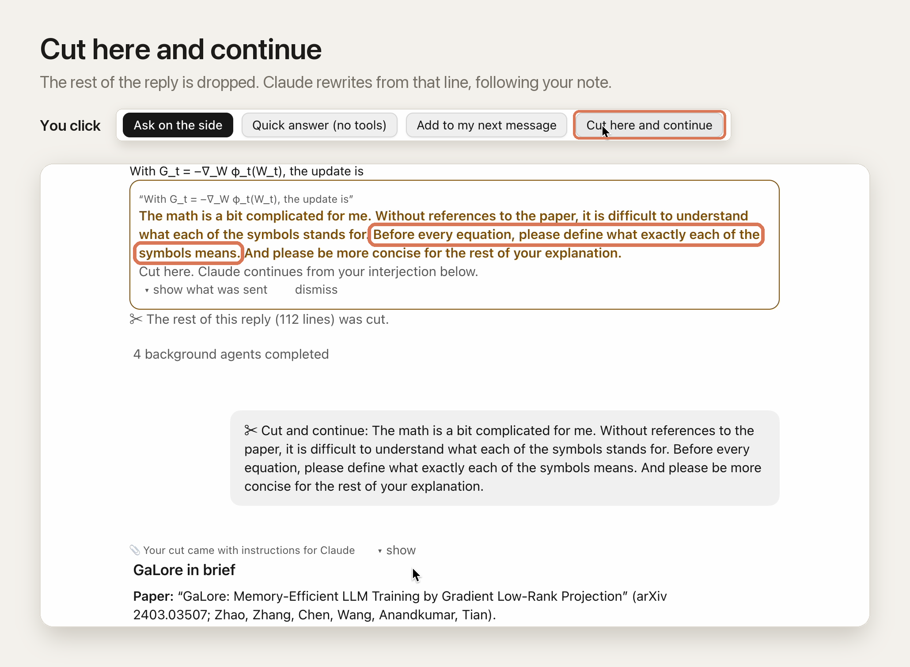
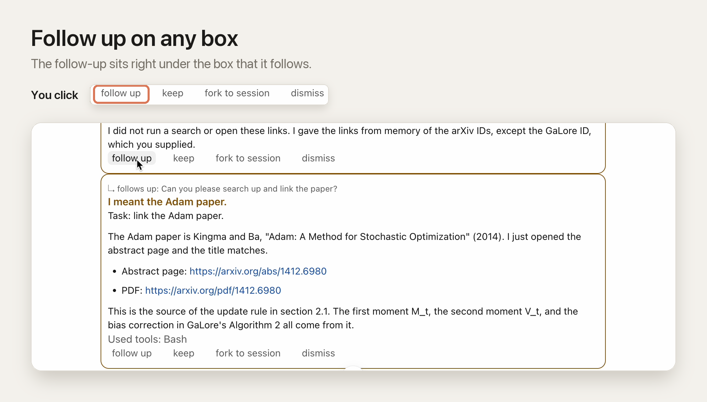
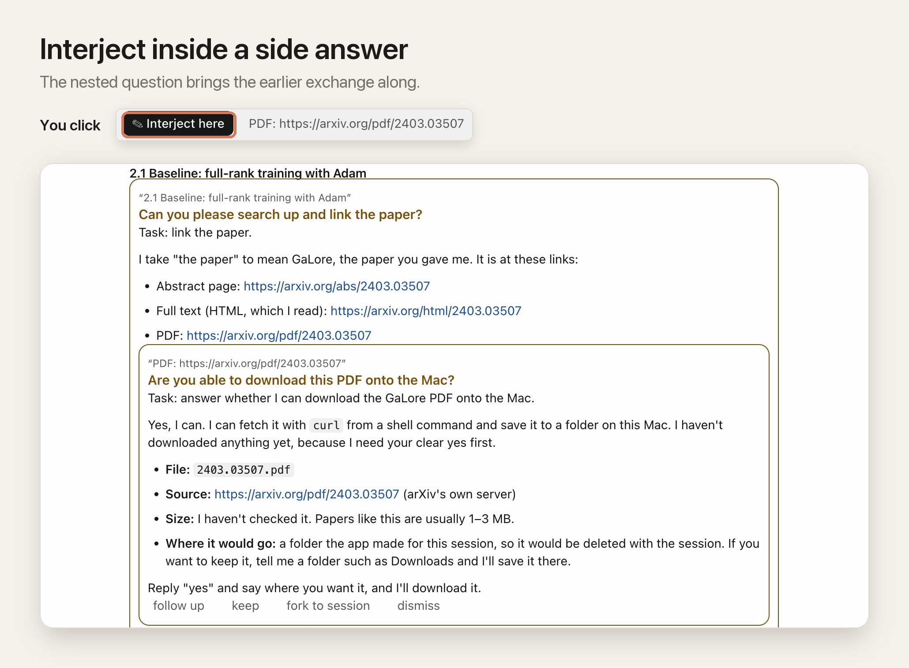
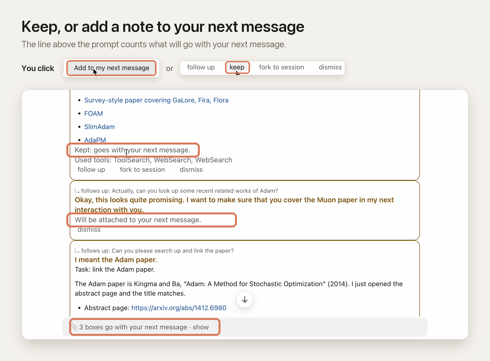
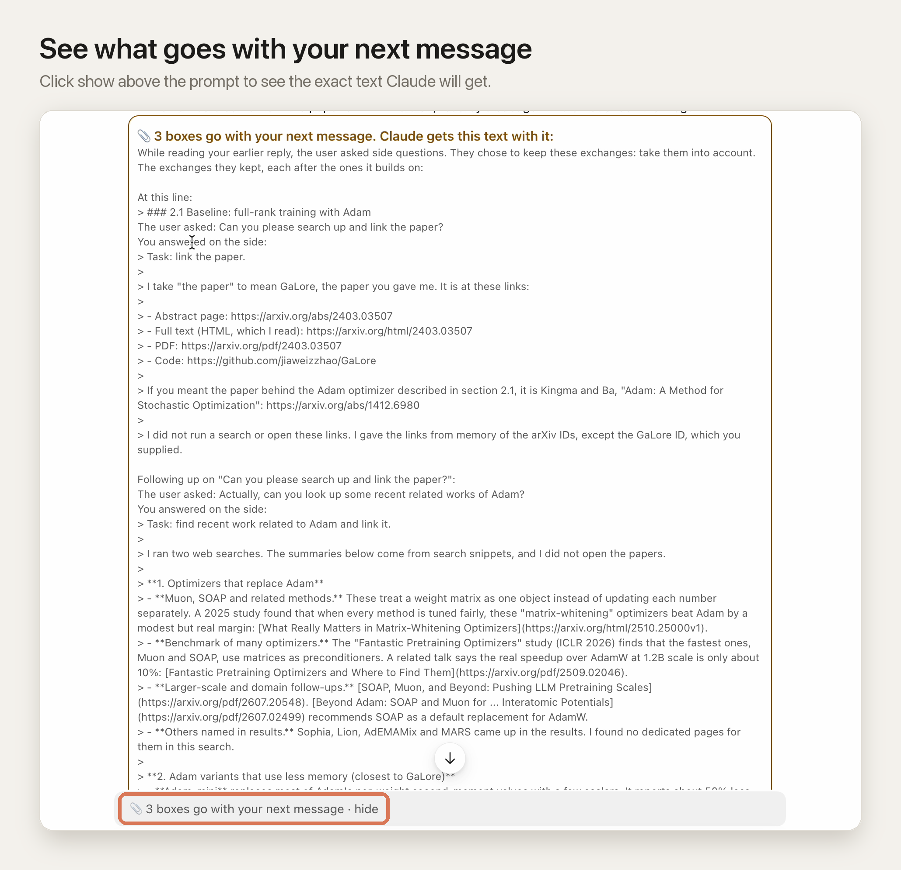
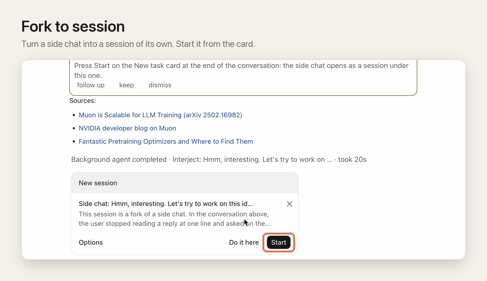
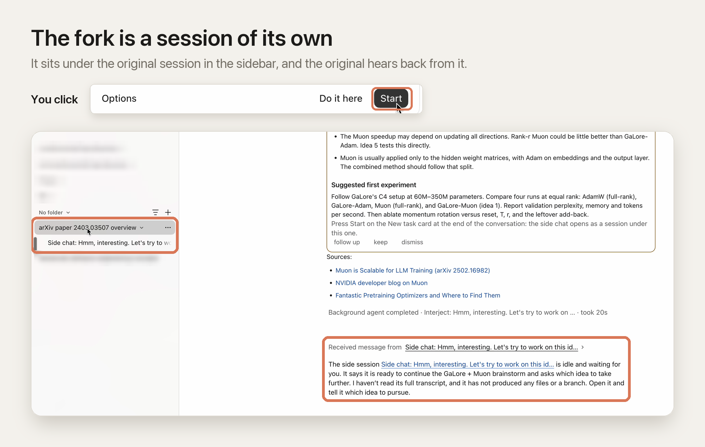

# interject

Ever get lost halfway through a long Claude reply? Claude Code already has
side chats and replies, but their answers float away from the line you
asked about. **Interject** is a small Claude Code mod (an add-on that
changes Claude Code's own screen) where **everything stays inline**, at the
line where you asked.

Stop at any line of a reply, even while Claude is still writing, and:

- **Send an agent with full tool use** (*Ask on the side*). It can read
  files, run commands and search the web, and its answer lands in a box
  right under the line.
- **Keep its answer for your next message**, so Claude builds on what you
  found out.
- **Cut the reply**, and Claude rewrites from that line, following your
  note.

You can also follow up on any answer, ask nested questions inside one, and
turn a side chat into its own session.

https://github.com/user-attachments/assets/b21f3111-a49e-40c1-90b6-1973be21706e

*A 3-minute narrated demo in Claude Code Desktop. Waits are cut or sped up.*

**Install** in Claude Code (2.1.275 or later) by typing:

```
/plugin install interject --marketplace The-Inscrutable-X/interject
```

Or ask your Claude to install Interject from this repository. Other ways
are under [Install](#install).

## What it looks like

<table>
<tr>
<td></td>
<td></td>
</tr>
<tr>
<td></td>
<td></td>
</tr>
<tr>
<td></td>
<td></td>
</tr>
<tr>
<td></td>
<td></td>
</tr>
<tr>
<td></td>
<td></td>
</tr>
</table>

Each picture shows what you click, then what you get. All 13 are in [`demo/stills/`](demo/stills/).

## How to use it

1. **Pick a line.** Select it with the mouse (click and drag, or
   triple-click for the whole line). A **✎ Interject here** button appears
   just above the prompt box: click it. Or type `/interject` and press
   Enter. With nothing selected, `/interject` lists the lines of the last
   reply instead: in Desktop and VS Code at the end of that reply, below
   what you are reading, so nothing moves; in the terminal in a small panel
   (arrow keys and Enter, or click). **Earlier reply** goes back one reply.
2. **Type your question.** In Claude Code Desktop and VS Code a form opens
   right under your line, inside the reply: click its field and type. The
   side panel never opens there. In the terminal, where a reply can't take typing, a small panel opens instead,
   with your line quoted at the top.
3. **Choose what happens:**
   - **Ask on the side** (or just press Enter): a **side chat**. A fork of
     the conversation works on your question in the background, and can use
     tools to do it (read files, run commands, search). The box under your
     line shows what it is doing, then its answer. The question, the work and
     the answer are **never added to the conversation**. In a Desktop
     session in auto mode the session won't start the side agent: Desktop
     gives its sessions auto mode rules of their own, and with rules set,
     Claude Code puts an agent a mod starts to the server-side check, which
     only judges calls one of Claude's replies asked for. There the side chat
     runs as a separate Claude Code process instead: `claude -p` forking this
     conversation (`--resume <this session> --fork-session`), unsaved, in
     auto mode, where auto mode judges each tool call against your question.
     It has the whole conversation and the same tools, but it doesn't share
     the session's prompt cache, so on a long conversation its first request
     costs more. Outside auto mode it runs in default mode, where a tool call
     that would need your approval is refused, since nobody can be asked
     there. If that can't start either, the answer comes from one plain model
     call over the conversation, without tools, and the box says so.
   - **Quick answer (no tools)**: the same box, answered in a few seconds
     by one request over the conversation, with no tools. Its box offers
     **ask again with tools** when it needs to look something up. The
     small **Enter ↵** beside the field is Desktop's hint for what Enter
     does: the same as **Ask on the side**.
   - **Add to my next message**: the box says it will be attached. When you
     next send a message, the quoted line and your note are added under it.
     The box then says "Attached".
   - **Cut here and continue**: everything in the reply after your line is
     withdrawn. Your interjection is sent for you, and Claude answers it and continues the reply from
     that line. The rest of the old reply is hidden behind a
     "✂ The rest of this reply … was cut" line. The message sent for you
     is one line, "✂ Cut and continue: " and your interjection; what Claude
     needs to continue from your line goes with it, as a note that Claude
     reads and you don't see. The note is added only once the message
     starts Claude's turn, so a cut that isn't sent leaves nothing behind.
   - **Cancel**, or press Esc.

**Interject on interjections.** A side answer is text like any other:
select a line inside its box and interject again. The new box sits at that
line of the answer, and all three choices carry the whole chain (your
first line, each question and answer so far, and the new line). Under
each side answer there are also:

- **follow up**: another question about the same line, with the earlier
  ones as context. Its box starts with one small line, "↳ follows up: …",
  naming the question it follows. Its form, and then its box, sit right
  under the box it follows, above that box's earlier follow-ups (newest
  first), not after whatever box came last at the line;
- **ask again with tools** (on a quick answer): the same question, now by a
  side chat that can use tools;
- **keep**: the question and answer go with your next message. So do the
  boxes it builds on: the box it sits inside, the one that box sits inside,
  and so on up, and any earlier question it follows up on. Each of those says
  "Kept with a question built on it" and loses its own keep button. Each box
  is sent once, however many boxes of one thread you keep, and a note added
  to the same message that follows up on a kept box names it instead of
  repeating it;
- **fork to session** (Desktop): the side chat goes on as a session of its
  own, forked from the conversation, named "Side chat: …". The mod asks
  Desktop for a **New task** card at the end of the conversation; press
  Start on it and the fork opens listed under this session, with the side
  chat as its brief. Nothing starts or costs anything until you press Start.
  Nothing is sent in your conversation either way.
  In auto mode Desktop's session tool is "always ask" and auto mode refuses
  it to a mod (no allow rule changes that), so there the mod forks it with
  Claude Code itself (`claude -p --resume <this session> --fork-session`,
  one short turn, which doesn't share this session's prompt cache) and
  opens it with Desktop's Resume link: it opens at once as a session of its
  own, not under this one;
- **dismiss**: removes the box (and boxes inside it), and stops a side chat
  that is still working.

Each box starts with the words you selected, in small text and in quotation
marks, with your question under it (a follow-up starts with the question it
follows instead). A box made by picking a line from the
list quotes the whole line.

**What goes with your next message.** While anything is waiting to go with
your next message (a kept box, a note added with **Add to my next message**,
or a cut that still needs Enter), the band above the prompt box says how
many boxes will go: "📎 2 boxes go with your next message · show". It sits
in the same row as ✎ Interject here. Click it, and a box at the end of the
latest reply shows the exact text that Claude will get; click it again, or
**hide** in that box, to close it. Only messages you send yourself take it, not Claude's tool calls,
and it waits however long you take. Once your message is sent, the line goes
away.

**Seeing what was sent.** Every box that went with a message (a note, a
kept box, a cut) has **▾ show what was sent**: it shows, in small text, the
exact text that Claude got for it, and **▴ hide** folds it again. Your own
message stays short:

- A cut's message is one line, "✂ Cut and continue: …", everywhere.
- In Desktop and VS Code, a message with boxes attached shows as you typed
  it: Desktop draws your messages itself, and a mod can't add to them.
  Instead, Claude's answer to it starts with a small line, "📎 Your message
  went with 2 boxes" (for a cut, "📎 Your cut came with instructions for
  Claude"), and its **▾ show** shows all that went with it. A message typed
  while Claude is still working goes into the reply already running, so it
  gets no such line; its boxes' **▾ show what was sent** still work.
- In the terminal, it shows as you typed it with a small
  "📎 Sent with 2 boxes" line, and **▾ show all that was sent** under it
  shows the whole message. ctrl+o's full transcript shows it too.

From the keyboard: `/interject ask <question>` asks on the side at the last
line of the latest reply; `/interject followup`, `/interject keep` and
`/interject fork` act on the latest side answer; `/interject next` opens the
text that goes with your next message at the end of the latest reply (the
way to see it in VS Code, which has no band); `/interject clear` removes every box.

Boxes are saved per session: resuming a session (`claude --resume`) brings
them back. So does switching conversations inside a running session
(`/resume`, `/clear`): within half a second, the mod
shows the boxes of the conversation now on screen. A session that goes on under a new id (Desktop resumes some that
way, and a fork is one) takes over the boxes of the one it continues as it
draws their replies: `replies.json` in the folder below records which
session holds the boxes of each reply. Each session's boxes are a folder of their own in
`~/.claude/interject-boxes/<session id>/` (set `INTERJECT_BOXES_DIR` to put
them somewhere else), as JSON page files of up to 3 MiB each. Every
session's are kept, with no limit on sessions, until you remove them:
`/interject clear` or dismiss in the session, or delete its folder.
Claude Code's file API has no delete, so a cleared page is written as `[]`.

What went with each message is saved once, apart from the boxes, in the
session's folder: the text in `sent/<id>.txt`, and which answer shows its
📎 line in `sends.json`. So it takes none of the boxes' room.

One session holds as many boxes as fit in the mod's state, which Claude
Code caps at 4 MiB: about 2,000 boxes. Past that, that session's oldest
boxes are removed, and a notice says so.

## Install

In Claude Code (2.1.275 or later), type:

```
/plugin install interject --marketplace The-Inscrutable-X/interject
```

Or from a shell:

```bash
claude plugin marketplace add The-Inscrutable-X/interject
claude plugin install interject@interject
```

Sessions started after that load it, in the terminal and in the Desktop
app's Code tab. To update: `claude plugin marketplace update interject`.
To remove: `claude plugin uninstall interject@interject`.

### Working on the mod

Clone this repository and point Claude Code at the folder instead: in
`~/.claude/settings.json`, under `env`, set `CLAUDE_CODE_PLUGIN_DIRS` to
the folder and `CLAUDE_CODE_PLUGIN_DIR_WATCH` to `1` (reload it when its
files change). Don't also install it from the marketplace, or it runs
twice. Run the tests with `claude plugin test .` in the folder.

For mouse selection in the terminal, fullscreen rendering must be on: type
`/tui` to check and `/tui fullscreen` to switch. In iTerm2, mouse reporting
must be on (Settings, Profiles, Terminal).

## What goes where

| | Side question | Add to my next message | Cut here and continue |
|---|---|---|---|
| Shown at the line | question and answer | note and its status | your interjection; the rest of the reply hidden |
| Added to the conversation | no | yes, with your next message | yes, at once, as a message from you |
| Sent to the model | a fork's own run: the conversation so far, the reply up to your line, any earlier questions in the chain, and the tool calls it makes | nothing until your next message | a new message: your line, the reply up to it, the chain, your interjection |

A side chat is a background agent: it starts from the conversation's prompt
cache, then costs what its own work costs (a question that needs no tools
is one request; one that reads files and runs commands is several), and it
counts toward your plan's usage like any request. While it works it shows in
the app's list of background tasks; when it finishes, the notice the
conversation would get is dropped, so the main thread never hears of it.

## Limits

- **A cut is an instruction, not a deletion.** Claude Code doesn't let a
  mod delete a saved reply. Claude is told the rest is withdrawn and the
  screen hides it, but a finished reply's full text stays in the
  conversation's memory. One exception: if you cut while Claude is still
  writing that part, the mod saves it ending at your line.
- **A cut doesn't undo work.** Files Claude changed or commands it ran after
  that line stay changed. Use `/rewind` for that.
- **Cutting an older reply** continues at the end of the conversation; the
  turns that came after that reply stay.
- **Clicking a line without selecting it** isn't possible: Claude Code only
  reports clicks on buttons and links, and turning every line into a button
  would lose the reply's formatting. Selecting, then clicking ✎, is the
  closest.
- **Typing `/interject` scrolls to the bottom**, because typing in the
  prompt box does that in Claude Code. The ✎ button avoids it.
- **Matching a selection to its line** compares the text you selected with
  the reply's markdown source, ignoring formatting marks and the web
  addresses of links. When the start of the selection still doesn't match
  (unusual formatting, a formula), the line that holds the most of its
  words in order is taken. If nothing matches, the form opens at the end of
  the reply.
- **The ✎ button** shows in the terminal and the Desktop app, not in VS
  Code (Claude Code has no space above the prompt there); use `/interject`.
- **The buttons inside a box** (follow up, keep, dismiss) need a mouse:
  fullscreen terminal, Desktop or VS Code. The keyboard forms are above.

## Files

- `.claude-plugin/plugin.json`: the mod's name and description
- `.claude-plugin/marketplace.json`: lets Claude Code install the mod from this repository
- `hooks/hooks.json`: points Claude Code at the code file
- `hooks/register.tsx`: all of the mod's code
- `types/index.d.ts`: the shape of the values the mod keeps (the boxes, the draft being typed, the current selection)
- `tests/interject.test.tsx`: automated tests (`claude plugin test .` in this folder)
- `demo/`: the demo videos and pictures
  - `demo/interject-desktop-demo.mp4`: the narrated demo in Claude Code Desktop (1080p), with two smaller copies: `demo/interject-desktop-demo-web.mp4` (1600 wide, for the blog) and `demo/interject-desktop-demo-720p.mp4` (under 10 MB, small enough for GitHub to play inside this page)
  - `demo/stills/`: one picture per feature, taken from that demo
  - `demo/video/`: the scripts that cut the demo from a screen recording, add the voiceover and music, and make the pictures. `demo/video/README.md` says how to run them
  - `demo/thread/`: a draft launch thread for X (`thread.md`), with its pictures, a 49-second teaser video, and `preview.html` to see it laid out
  - `demo/interject-demo.mp4`: an older demo in the terminal, with the scripts that recorded it (`drive.py`, `render2.py`, `steps.py`)

## License

MIT. See `LICENSE`.
